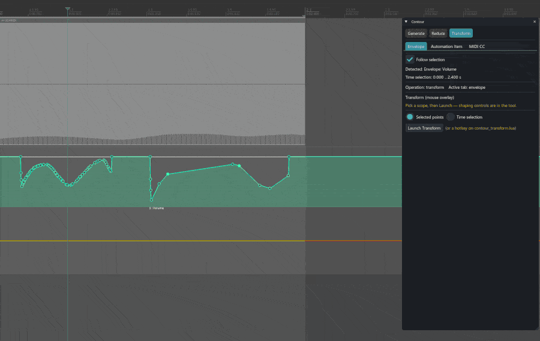
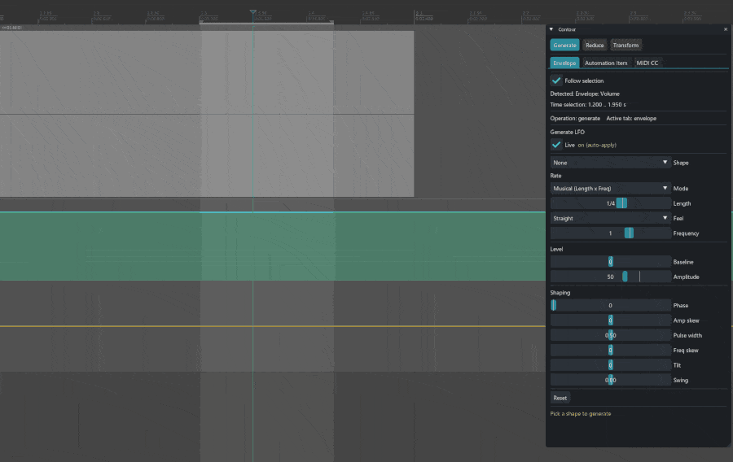
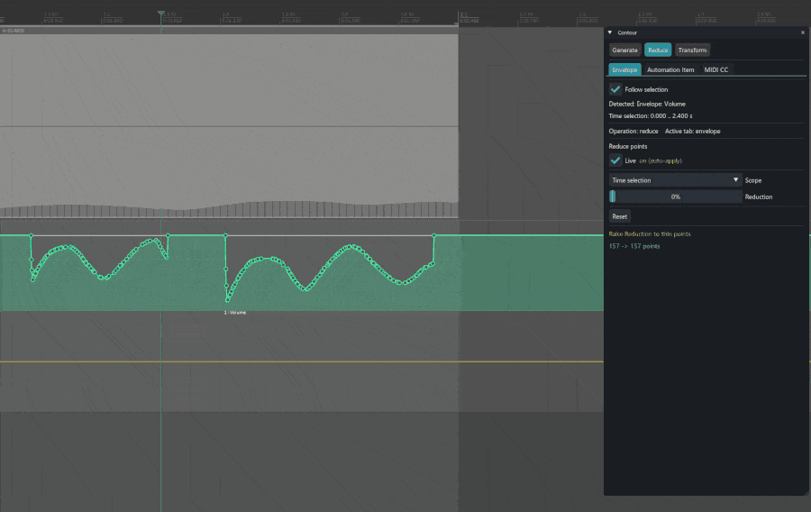

# Contour

**A unified LFO / point-reduce / transform toolkit for REAPER — one panel for track & take envelopes, automation items, and MIDI CC.**

Contour replaces a pile of scattered modulation and shaping tools with a single [ReaImGui](https://github.com/cfillion/reaimgui) window built around three operations over four targets:

| Operation | What it does |
|-----------|--------------|
| **Generate** | Draw LFO shapes (sine, square, saw, triangle, parametric, …) onto the target, with a live, non-destructive preview that matches REAPER's native CC LFO. |
| **Reduce** | Thin point density with an adjustable tolerance — live and non-destructive. |
| **Transform** | A mouse overlay to **stretch / scale / compress / warp / tilt / reverse / flip** the selected points (or a time selection or razor area) directly under the cursor. |

All three work on **track envelopes**, **take envelopes**, **automation items**, and **MIDI CC** (any visible CC lane, any MIDI channel).

## In action

**Transform** — grab the colour-coded handles on the shape and drag (stretch / scale / warp / tilt):



**Generate** an LFO with a live preview, and **Reduce** point density non-destructively:





The same panel follows your context and works identically on take envelopes, automation items, and MIDI CC.

---

## Requirements

REAPER 7+ with two extensions (both free, both installed via ReaPack):

| Extension | Needed for | Where |
|-----------|-----------|-------|
| **ReaImGui** | the panel UI (everything) | ReaTeam Extensions repo (bundled with ReaPack) |
| **js_ReaScriptAPI** | the Transform overlay | ReaTeam Extensions repo |
| **SWS** *(optional)* | sharpens a few edge cases (looped-item lengths, exotic FX-parameter envelopes) | <https://www.sws-extension.org> |

These are **not** bundled with Contour — see [Installing the dependencies](#installing-the-dependencies). If one is missing, Contour tells you which and how to get it.

---

## Install (via ReaPack)

1. In REAPER: **Extensions → ReaPack → Import a repository…**
2. Paste this URL:
   ```
   https://github.com/dtrebjesanin/reaper-contour/raw/master/index.xml
   ```
3. **Extensions → ReaPack → Synchronize packages**, then find **Contour** in **Browse packages** and install it.

This installs two actions (see below) plus all of Contour's internal modules in one go.

### Installing the dependencies

Open **Extensions → ReaPack → Browse packages** and install:

- **ReaImGui: ReaScript binding for Dear ImGui** — from the default *ReaTeam Extensions* repository.
- **js_ReaScriptAPI: API functions for ReaScripts** — same repository.
- **SWS/S&M Extension** *(optional)* — from <https://www.sws-extension.org> (a normal installer, not ReaPack). Most setups have it anyway; Contour runs fine without it.

---

## The two actions

After installing, search the **Actions** list (Actions → Show action list) for:

- **Script: Contour** — the main panel. Run it to open the window.
- **Script: Contour Transform** — the mouse-overlay tool. You can launch it from the panel's *Transform* tab, run it directly, or **bind it to a hotkey**. (A MIDI-Editor hotkey is handy, since Transform also works on CC lanes.)

---

## Usage

**The active target follows what you're working on.** Select an envelope or automation item in the arrange, or select CC points in the MIDI editor, and Contour switches to that target automatically (you can also pick the tab manually or turn off *Follow*).

**Razor areas work as a per-lane time selection.** The time selection covers every track; a razor area belongs to one lane. When the target lane has a razor area, Contour works inside it instead of the time selection, and the context line shows its range. The **Scope** dropdown in Generate, Reduce and Transform names the range: it reads **Razor area** (or **Razor areas**) when the lane has one, and **Time selection** when it does not.

- Drag a razor area on **one envelope lane** and Contour switches to that lane (with *Follow* on).
- Drag across **several lanes** and the context line offers a lane chooser instead. Contour only ever changes the lane it targets.
- **Generate** writes one LFO into each area on the lane, **Reduce** thins each area (one undo step either way), and **Transform** works on the lane's one area.
- On a **take envelope**, the razor area on the item lane counts. An automation item or item uses only the part of the area inside it. **MIDI CC** keeps the time selection.

**Colours.** The **…** button after the target tabs picks a palette. **Auto** (the default) follows your REAPER theme; **Contour** is the original look; Cassatt, Kandinsky, Tam, Paquin and Klimt are alternatives. On a wide window, Generate lays its settings out in two columns.

- **Generate** — pick the target, choose a shape + rate + amplitude (+ phase, swing, skew…), watch the live preview, then apply. Output replaces the time selection or razor area.
- **Reduce** — choose a scope (time selection or razor area / entire item / selected points) and drag the amount; the preview thins the points live. 0% restores the original. A razor area on the lane takes the place of the time selection.
- **Transform** — make a selection (points, time, or a razor area), launch the overlay, and drag the on-shape handles. Run directly (action or hotkey), Transform takes a razor area on the lane over selected points; with several areas on the lane, it asks for one:
  - **↔ Stretch** (horizontal), **↕ Scale / Compress** (vertical, via the Curve knob), **✕ Warp** (push a region in X and/or Y), **↻ Tilt**.
  - **Shift + ✕ centre handle** moves every point by the same amount on one axis: up/down (values) or left/right (times), locked to the direction you start in. A left/right move stops as a block at the item edge; release Shift mid-drag to go back to Warp.
  - **Mouse wheel** = Curve · **Middle-click** = Power/Sine · **Right-click** = Symmetrical — each change echoes on the HUD's status line, so the shortcuts work with the panel collapsed too.
  - **Reverse / Flip / Reset** buttons in the overlay HUD. Each drag is one undo step.
  - **Small handles** (HUD checkbox) draws the handles as small coloured dots, for short selections.
  - Symmetrical, Power/Sine, the Flip mode and Small handles are **remembered between launches**; Curve always starts linear.
  - The HUD panel is **draggable**, **collapses** to a slim status strip, and the **pin button** saves its position as the default across sessions (unpin to return it to the box corner).

---

## Troubleshooting

- **"Contour needs …" dialog on launch** — install the named extension via ReaPack (see above), then restart REAPER.
- **The Transform "Launch" button says it can't find the action** — run *Contour Transform* once from the Action list (that registers it), then use the panel button again.
- **Wrong target detected** — Contour follows window focus and selection. Click the surface you want (the envelope lane, or the CC lane), or pick the tab manually.
- **A razor area is ignored** — it counts only on the lane Contour targets (the envelope lane itself, or the item lane for a take envelope), and not for MIDI CC. Drag it on that lane, or pick the lane in the chooser.

---

## Credits

- **Transform** is an original re-imagining of the mouse-editing workflow popularized by **juliansader's _js_Mouse editing — Multi Tool_** — built from scratch on a different engine so it stays smooth on envelopes and automation items, not only MIDI CC.
- The **native CC LFO match** was reverse-engineered empirically from REAPER's own output and locked with integer-exact test fixtures.
- Built with **[ReaImGui](https://github.com/cfillion/reaimgui)**, **js_ReaScriptAPI**, and **SWS**, and packaged with **[ReaPack](https://reapack.com)** — all by cfillion and the REAPER community.

No third-party code is copied into Contour; it builds on shared techniques, APIs, and reverse-engineered facts.

---

## License

[GNU General Public License v3.0](LICENSE) (or later). You're free to use, study, share, and modify Contour; modified versions you distribute must stay open under the GPL.

---

## For developers

The repository ships only the `Contour/` folder via ReaPack. The rest is development-only and **not** installed:

- `dev/` — diagnostic scripts (coordinate dumps used while reverse-engineering REAPER's coordinate frames).
- `tests/` — headless test suite. Run with a standalone Lua 5.4 from the repo root:
  ```
  lua tests/test_<name>.lua      # one file, e.g. lua tests/test_transform.lua
  for %f in (tests\test_*.lua) do lua "%f"   # all of them (cmd); use a shell loop on *nix
  ```
  The suite has three layers, all runnable without REAPER except the last:
  - **Engine/core** (`test_lfo`, `test_native_match`, `test_shapes`, `test_reduce`, `test_transform`,
    `test_customshape`, `test_target`, `test_context`, …) — the pure logic; `test_native_match` byte-matches
    REAPER's native CC LFO and must stay green.
  - **UI render-smoke** (`test_render_smoke`) — installs a fake `reaper` (`tests/reaper_stub.lua`) and calls
    every panel's `draw()` (and the Transform overlay's `start`→`frame`→one-shots) across a matrix of shapes,
    modifiers, targets and ops, failing on any throw. This catches the nil-global / missing-function class of
    bug that the engine tests can't (e.g. the overlay `bounds` crash).
  - **Option-matrix sweep** (`test_generate_sweep`) — drives the real panel→engine param path
    (`generate._buildParams` → `lfo.generate`) across every shape × modifier × value-range, asserting output
    invariants. Automates the bulk of what used to be manual click-through.
- `tests/reaper/contour_selftest.lua` — an **in-REAPER** integration self-test. Load it from REAPER's Action
  list and Run it: it creates a scratch track, round-trips Contour's real write→read against the live REAPER
  API for envelopes / MIDI CC / automation items / razor areas, prints PASS/FAIL to the ReaScript console, then deletes the
  scratch track. Use it to confirm the real API behaves as the headless stubs assume.
- `docs/` — design specs and implementation plans.

`index.xml` is generated automatically by `.github/workflows/deploy.yml` on every push to `master`; don't hand-edit it. To cut a release, bump `@version` and add a `@changelog` line in `Contour/contour.lua`, then commit and push.
